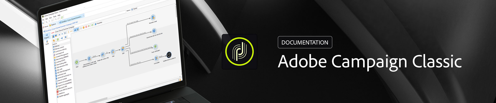

# Campaign Classic v7 설명서 {#campaign-classic-documentation}

이 설명서는 **온-프레미스 및 하이브리드** 배포를 위한 Campaign Classic v7에 대해 설명합니다. 설치, 구성, 업그레이드, 작업 및 v7에만 해당하는 기능. 인스턴스가 Adobe(Managed Cloud Services)에서 호스팅되는 경우 [Campaign v8 설명서](https://experienceleague.adobe.com/ko/docs/campaign/campaign-v8/campaign-home){target="_blank"}를 참조하세요. Campaign v8 문서를 같은 방식으로 복사하는 콘텐츠는 더 이상 여기에서 복제되지 않습니다. [v7에서 v8까지](#from-v7-to-v8)를 참조하세요.

<!-- -->

## 새로운 기능

Adobe Campaign Classic v7 제품 및 설명서의 최신 개선 사항을 살펴보십시오! 기능, 개선 사항, 수정 사항을 종합한 목록은 상세한 [릴리스 정보](rn/using/latest-release.md)에서 확인할 수 있습니다.

>[!BEGINTABS]

>[!TAB 2026년 10월 릴리스가 공개되었습니다!]

Campaign Classic v7.4.5 - 2026년 10월 빌드(빌드 9420)는 Analytics 외부 계정에 대한 수정 사항, 개인화 보류 상태에서 중단된 게재, 서버 CPU 사용, 간헐적인 데이터 모델 업데이트 오류, 게재 만들기의 스팸 확인 오류 및 반복되는 소프트 바운스 격리를 제공합니다.

>[!TAB Adobe IMS로 이동]

보안 및 인증 프로세스를 강화하기 위해 Adobe Campaign은 최종 사용자 인증 모드를 로그인/암호 기본 인증에서 Adobe IMS(Identity Management System)로 마이그레이션할 것을 강력히 권장합니다.

>[!ENDTABS]

## 기본 사항으로 시작

<table style="table-layout:fixed">
  <tr style="border: 0;">
    <td>
    </a>
    
<strong>Adobe Campaign 시작</strong> Campaign 클라이언트 콘솔을 실행하고 Campaign 애플리케이션 서버에 연결하는 방법에 대해 알아봅니다.

    </td>
    <td>
    
    
<strong>프로필 추가 및 관리</strong> Adobe Campaign v7 데이터베이스의 프로필 관리를 쉽게 살펴볼 수 있습니다. 수동으로 또는 가져오기를 통해 프로필을 추가하여 고객 데이터를 세분화하고 캠페인을 손쉽게 사용자 지정할 수 있습니다.

    </td>
    <td>
    
    
<strong>워크플로로 자동화</strong> 워크플로를 활용하여 세분화, 캠페인 실행, 파일 처리, 인원 참여 등의 프로세스를 디자인하는 방법을 알아봅니다.
    
</td>
    <td>
    
    
<strong>게재 만들기</strong> 여러 채널(이메일, SMS, 푸시 알림 등)에서 메시지를 보내는 방법을 알아봅니다.

    </td>
  </tr>
  <tr style="border: 0;">
    <td align="center"></td>
    <td align="center"></td>
    <td align="center"></td>
    <td align="center"></td>
    </tr>
</table>

## 설명서 살펴보기

<table style="table-layout:auto">
  <tr style="border: 0;">
    <td>
      
     
      <strong>시작</strong> <a href="https://experienceleague.adobe.com/ko/docs/campaign/campaign-v8/new/campaign-ui" target="_blank">사용자 인터페이스</a>(Campaign v8 설명서) - <a href="platform/using/launching-adobe-campaign.md">Campaign에 연결</a> - <a href="https://experienceleague.adobe.com/ko/docs/campaign/campaign-v8/data/import" target="_blank">데이터 가져오기 및 내보내기</a>(Campaign v8 설명서) - <a href="platform/using/access-management.md">권한</a>
    </td>
    <td>
      
     
      <strong>고객 경험</strong> <a href="https://experienceleague.adobe.com/ko/docs/campaign/automation/workflows/introduction/about-workflows" target="_blank">워크플로우 자동화</a>(Campaign v8 설명서) - <a href="https://experienceleague.adobe.com/docs/campaign/automation/campaign-orchestration/set-up-campaigns.html?lang=ko" target="_blank">마케팅 캠페인</a> - <a href="interaction/using/interaction-and-offer-management.md">상호 작용 및 오퍼 관리</a> - <a href="delivery/using/about-personalization.md">Personalization</a> - <a href="https://experienceleague.adobe.com/ko/docs/campaign/campaign-v8/analytics/reports/gs-reporting" target="_blank">보고</a>(Campaign v8 설명서)
    </td>
    <td>
      
     
      <strong>메시지 전송</strong> <a href="delivery/using/communication-channels.md">커뮤니케이션 채널</a> - <a href="https://experienceleague.adobe.com/ko/docs/campaign/campaign-v8/send/create-message" target="_blank">교정쇄 전송</a>(Campaign v8 설명서) - <a href="delivery/using/get-started-a-b-testing.md">A/B 테스트</a> - <a href="https://experienceleague.adobe.com/ko/docs/campaign/campaign-v8/analytics/tracking/tracking" target="_blank">메시지 추적</a> - <a href="delivery/using/about-deliverability.md">전달성</a> - <a href="message-center/using/about-transactional-messaging.md">트랜잭션 메시지</a>
    </td>
  </tr>
  <tr style="border: 0;">
    <td>
      
       
      <strong>프로필 및 대상자</strong>  <a href="https://experienceleague.adobe.com/ko/docs/campaign/campaign-v8/audience/create-audiences/create-audiences" target="_blank">목록 생성</a>(Campaign v8 설명서) - <a href="delivery/using/about-services-and-subscriptions.md">서비스 및 구독</a> - <a href="platform/using/privacy-management.md">개인정보 보호 및 동의</a>
    </td>
    <td>
      
       
      <strong>아키텍처 및 구성</strong> <a href="production/using/general-architecture.md">아키텍처 원칙</a> - <a href="production/using/build-upgrade.md">빌드 업그레이드 수행</a> - <a href="production/using/configuration.md">Campaign 구성</a> - <a href="installation/using/external-accounts.md">외부 시스템에 연결</a>
    </td>
    <td>
      
       
      <strong>개발자 리소스</strong> <a href="https://experienceleague.adobe.com/ko/docs/campaign/campaign-v8/developer/datamodel" target="_blank">데이터 모델 설명</a>(Campaign v8 설명서) - <a href="configuration/using/about-schema-reference.md">스키마 구조</a> - <a href="configuration/using/editing-forms.md">입력 양식</a> - <a href="configuration/using/about-web-services.md">API</a> - <a href="https://experienceleague.adobe.com/ko/tools/campaign-api">JSAPI 참조 설명서</a> - <a href="configuration/using/about-custom-recipient-table.md">사용자 지정 수신자 테이블</a>
    </td>
  </tr>
</table>

## v7에서 v8까지 {#from-v7-to-v8}

Campaign v8 설명서에 설명된 콘텐츠는 v7 설명서에서 제거되었습니다. 이 표를 사용하여 찾아보십시오.

| 찾고 있는 경우... | Campaign v8 설명서로 이동 |
| --- | --- |
| 사용자 인터페이스 | [사용자 인터페이스 검색](https://experienceleague.adobe.com/ko/docs/campaign/campaign-v8/new/campaign-ui){target="_blank"} |
| 프로필, 목록, 가져오기 및 내보내기 | [프로필 및 데이터 가져오기](https://experienceleague.adobe.com/ko/docs/campaign/campaign-v8/data/import){target="_blank"} |
| 워크플로 | [워크플로우 정보](https://experienceleague.adobe.com/ko/docs/campaign/automation/workflows/introduction/about-workflows){target="_blank"} |
| 마케팅 캠페인 | [마케팅 캠페인 시작](https://experienceleague.adobe.com/ko/docs/campaign/automation/campaign-orchestration/set-up-campaigns){target="_blank"} |
| 게재 만들기 및 보내기 | [메시지 만들기](https://experienceleague.adobe.com/ko/docs/campaign/campaign-v8/send/create-message){target="_blank"} |
| 기본 제공 보고서 | [보고 시작](https://experienceleague.adobe.com/ko/docs/campaign/campaign-v8/analytics/reports/gs-reporting){target="_blank"} |
| 권한 | [사용 권한 시작](https://experienceleague.adobe.com/ko/docs/campaign/campaign-v8/permissions/gs-permissions){target="_blank"} |
| 입력 양식 | [입력 양식 시작](https://experienceleague.adobe.com/ko/docs/campaign/campaign-v8/developer/schemas-forms/forms){target="_blank"} |

## 추가 리소스

[Adobe Campaign 제품 설명](https://helpx.adobe.com/kr/legal/product-descriptions/adobe-campaign-managed-cloud-services.html){target="_blank"} - [호환성 매트릭스](rn/using/compatibility-matrix.md) - [튜토리얼](https://experienceleague.adobe.com/docs/campaign-classic-learn/tutorials/overview.html?lang=ko){target="_blank"} - [Campaign용 컨트롤 패널](https://experienceleague.adobe.com/docs/control-panel/using/discover-control-panel/key-features.html?lang=ko){target="_blank"} - [이메일 추적 픽셀 및 CNIL 지침](https://experienceleague.adobe.com/ko/docs/campaign/campaign-v8/new/cnil-pixel-tracking){target="_blank"}
