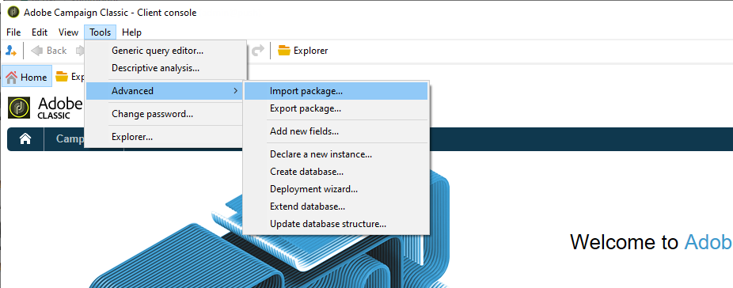
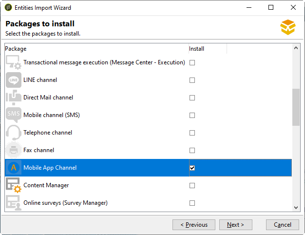
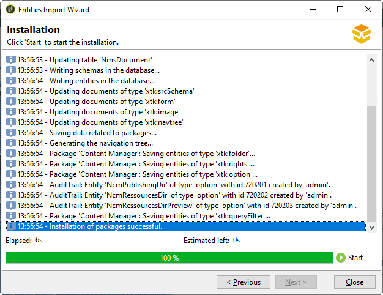

# 모바일 앱 채널 시작{#about-mobile-app-channel}

Adobe Campaign을 사용하여 푸시 알림 게재를 만들어 개인화된 메시지를 모바일 앱 사용자에게 보냅니다.

Campaign v7에서 v8로 전환하는 과정의 일부로 Campaign Classic 설명서 세트가 간소화 및 재구성되었습니다. 이제 일반적인 기능은 Campaign v8 설명서 세트에서만 사용할 수 있습니다. 푸시 알림 채널에 대한 자세한 내용은 [Campaign v8 설명서](https://experienceleague.adobe.com/en/docs/campaign/campaign-v8/send/push/push){target=_blank}를 참조하세요.

{target=_blank}

다음 정보는 Campaign Classic에만 해당됩니다.

+++ **패키지 설치**

 [비디오에서 모바일 앱 패키지를 설치하는 방법을 알아봅니다](https://experienceleague.adobe.com/docs/campaign-classic-learn/tutorials/sending-messages/push-channel/installing-the-mobile-app-channel.html#sending-messages)

하이브리드/호스팅 고객은 [Adobe 고객 지원 센터](https://helpx.adobe.com/kr/enterprise/admin-guide.html/enterprise/using/support-for-experience-cloud.ug.html) 팀에 문의하여 Campaign의 푸시 알림 채널에 액세스하십시오.

온-프레미스 고객은 기본 제공 패키지를 설치해야 합니다.

>[!CAUTION]
>
>[이 페이지](../../installation/using/installing-campaign-standard-packages.md)에서 Campaign 기본 제공 패키지, 모범 사례 및 권장 사항에 대해 자세히 알아보세요.

설치 단계는 다음과 같습니다.

1. Adobe Campaign 클라이언트 콘솔의 **[!UICONTROL Tools > Advanced > Import package]**&#x200B;에서 패키지 가져오기 도우미에 액세스합니다.

   

1. **[!UICONTROL Install a standard package]**&#x200B;을(를) 선택합니다.

1. 표시되는 목록에서 **[!UICONTROL Mobile App Channel]**&#x200B;을(를) 선택합니다.

   

1. 패키지 설치를 시작하려면 **[!UICONTROL Next]**&#x200B;을(를) 클릭한 다음 **[!UICONTROL Start]**&#x200B;을(를) 클릭합니다.

   패키지가 설치되면 진행률 표시줄에 **100%**&#x200B;이(가) 표시되며, 설치 로그에 **[!UICONTROL Installation of packages successful]** 메시지가 표시됩니다.

   

1. **[!UICONTROL Close]** 설치 창을 엽니다.

이 단계를 완료하면 Android 및 iOS 앱을 구성할 수 있습니다. Campaign v8 [설명서](https://experienceleague.adobe.com/docs/campaign/campaign-v8/send/push/push.html){target="_blank"}를 참조하세요.

+++

+++ **문제 해결**

모바일 장치가 Wi-Fi에 연결되어 있고 알림을 받지 못하는 경우, FCM/APNs 포트가 방화벽에 의해 차단되고 있지 않은지 확인하십시오.

**Android**: 모바일 장치가 포트 5228에서 5230까지의 FCM 서버에 연결됩니다. 따라서 FCM과의 연결을 승인하도록 방화벽을 구성해야 합니다. 열려는 포트는 5228(가장 자주 사용됨), 5229 및 5230입니다.

**iOS**:

HTTP/2 커넥터: 다음 서버와의 통신을 허용해야 합니다.

* api.push.apple.com: 포트 443
* api.development.push.apple.com: 포트 443

>[!NOTE]
>
>두 커넥터에 대한 자세한 내용은 Campaign v8 [설명서](https://experienceleague.adobe.com/docs/campaign/campaign-v8/send/push/push-settings.html){target="_blank"}를 참조하세요.

+++
