# 워크플로로 자동화{#automating-via-workflows}

워크플로우를 사용하여 콘텐츠 관리 콘텐츠를 작성, 편집 및 게시할 수 있습니다.

Campaign v7에서 v8로 전환하는 과정의 일부로 Campaign Classic 설명서 세트가 간소화 및 재구성되었습니다. 이제 일반적인 기능은 Campaign v8 설명서 세트에서만 사용할 수 있습니다. **콘텐츠 관리** 활동을 구성하는 방법에 대해 알아보려면 [Campaign v8 설명서](https://experienceleague.adobe.com/ko/docs/campaign/automation/workflows/wf-activities/action-activities/content-management){target=_blank}를 참조하세요.

[](https://experienceleague.adobe.com/ko/docs/campaign/automation/workflows/wf-activities/action-activities/content-management){target=_blank}

## 예제 {#examples}

### 컨텐츠 생성 및 전달 자동화 {#automating-content-creation-and-delivery}

다음 예제에서는 콘텐츠 블록의 만들기 및 전달을 자동화합니다.

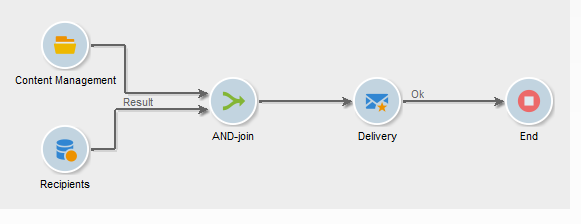

콘텐츠는 &quot;콘텐츠 관리&quot; 활동을 통해 구성됩니다.

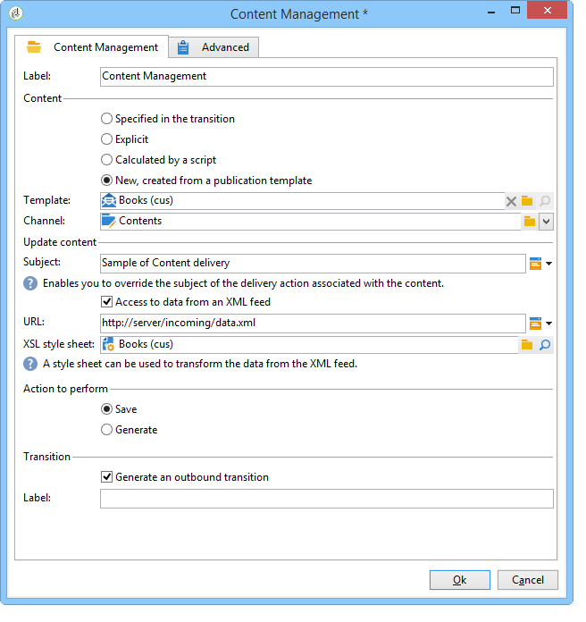

게시 모델 및 콘텐츠 문자열 폴더를 통해 새 콘텐츠 인스턴스가 만들어집니다.

이 예제에서는 게재 제목을 오버로드했습니다. **[!UICONTROL Delivery]** 템플릿에 입력한 항목 대신 고려됩니다.

입력한 URL에서 제공되는 XML 피드에 의해 콘텐츠가 자동으로 채워집니다.

```
<?xml version='1.0' encoding='ISO-8859-1'?>
<book name="Content automation test" date="2008/06/08" language="eng" computeString="Content automation test">
  <section id="1" name="Introduction">
    <page>Introduction to input forms.</page>
  </section>
</book>
```

데이터 형식이 게시 템플릿(**cus:book**)에 입력한 데이터 스키마와 일치하지 않습니다. **`<section>`** 요소를 **`<chapter>`** 요소로 바꿔야 합니다. 필요한 변경을 수행하려면 &quot;cus:book-workflow.xsl&quot; 스타일시트를 적용해야 합니다.

사용된 XSLT 스타일시트의 Source 코드:

```
<?xml version="1.0" encoding="utf-8"?>
<xsl:stylesheet version="1.0" xmlns:xsl="http://www.w3.org/1999/XSL/Transform">
 <xsl:output indent="yes" method="xml"  encoding="ISO-8859-1"/>

 <xsl:template match="text()|@*"/>

  <xsl:template match="*">
    <xsl:variable name="element.name" select="name(.)"/>
    <xsl:element name="{$element.name}">
      <xsl:copy-of select="text()|@*"/>
      <xsl:apply-templates/>
    </xsl:element>
  </xsl:template>

  <xsl:template match="book">
  <book name="test">
     <xsl:apply-templates/>
    <book>
 </xsl:template>

  <xsl:template match="section">
    <chapter>
      <xsl:for-each select="@*">
        <xsl:copy-of select="."/>
      </xsl:for-each>
       <xsl:apply-templates/>
    </chapter>
  </xsl:template>
  
</xsl:stylesheet>
```

활동의 마지막 작업은 콘텐츠 인스턴스를 저장하고 다음 작업으로 진행하는 것입니다.

타깃팅은 **쿼리** 활동을 통해 수행됩니다.

대상 쿼리 및 콘텐츠 업데이트가 완료된 후에만 게재를 시작하도록 **AND-join** 활동이 추가되었습니다.

게재 작업은 **게재** 활동을 통해 구성됩니다.

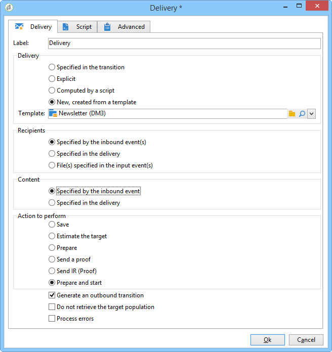

템플릿을 기반으로 새 게재 작업이 생성됩니다.

활동의 게재 템플릿은 게시 템플릿의 변형 템플릿을 선택하는 데 사용됩니다. 콘텐츠 생성은 게재 템플릿이 없는 모든 HTML 및 텍스트 템플릿 또는 활동과 동일한 템플릿을 사용하여 참조되는 템플릿을 고려합니다.

전달할 대상이 들어오는 이벤트를 통해 입력됩니다.

게재 콘텐츠는 들어오는 이벤트를 통해 채워집니다.

활동을 완료하는 마지막 단계는 게재를 준비한 다음 시작하는 것입니다.

### 나중에 게시할 콘텐츠 만들기 {#creating-content-and-publishing-it-later}

이 예제에서는 콘텐츠 블록을 만들고 특정 시간 지연 후 파일 게시를 시작합니다.

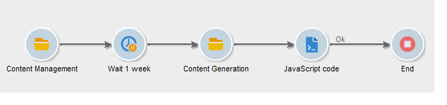

첫 번째 **콘텐츠 관리** 작업에서 콘텐츠 인스턴스를 만듭니다.

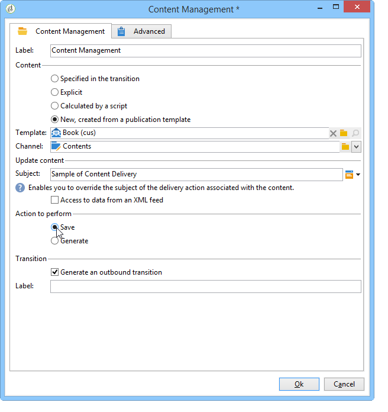

>[!NOTE]
>
>변환 템플릿 창의 **[!UICONTROL Publication]** 탭은 생성할 대상의 위치로 채워야 합니다.

일주일 동안 다음 전환을 일시 중지하기 위해 대기 활동이 추가됩니다.

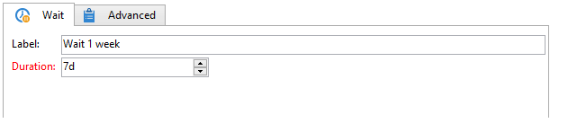

이 기간 동안 콘텐츠를 수동으로 입력합니다.

다음 작업은 콘텐츠 생성을 시작합니다.

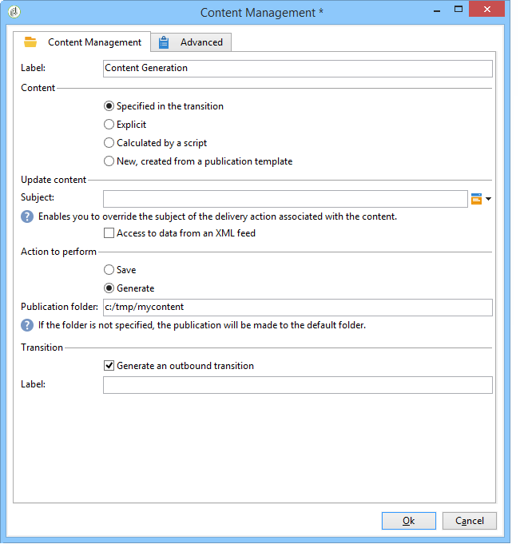

게시할 콘텐츠는 들어오는 전환을 통해 입력됩니다.

마지막 작업은 게시 디렉터리를 강제 실행하여 이 콘텐츠를 생성하는 것입니다.

**JavaScript 코드** 활동은 생성된 각 파일의 전체 이름을 검색합니다.

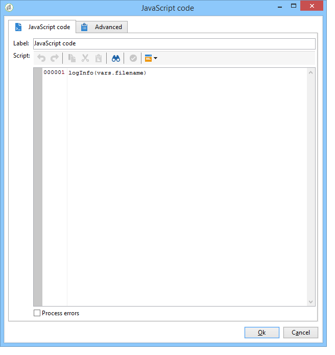

### 게재 및 해당 콘텐츠 만들기 {#creating-the-delivery-and-its-content}

이 예제에서는 첫 번째 예와 동일한 개념을 사용하고 첫 번째 단계에서만 게재 작업을 생성합니다.

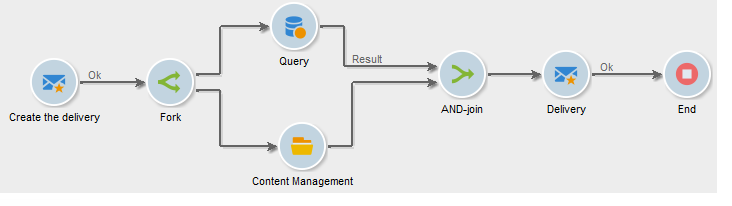

처음 **게재 만들기** 작업은 게재 작업을 만듭니다.

포크 활동을 사용하면 대상 계산과 컨텐츠 인스턴스 생성을 동시에 시작할 수 있습니다.

작업이 실행되면 AND-조인 상자가 **게재** 작업을 활성화하여 콘텐츠 및 타겟팅에서 이전에 만든 게재를 시작합니다.

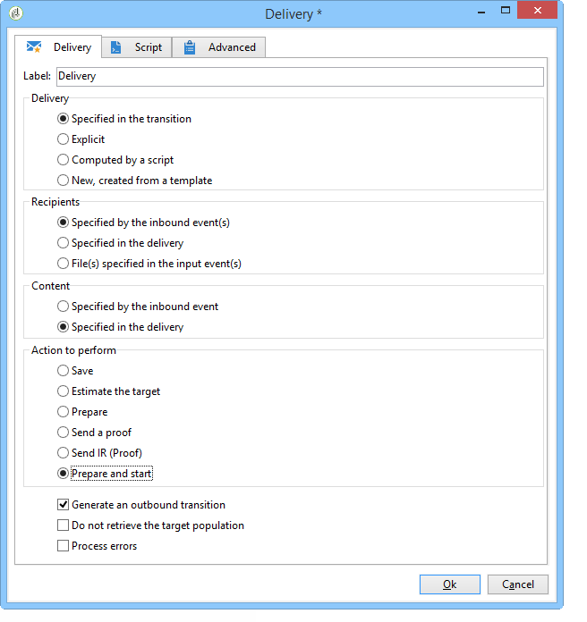

시작할 게재 작업은 전환을 통해 채워집니다.

전달할 대상이 들어오는 이벤트를 통해 입력됩니다.

게재 콘텐츠는 들어오는 이벤트를 통해 채워집니다.

활동의 마지막 작업은 게재를 준비하고 시작하는 것입니다.

### Amazon Simple Storage Service(S3) 커넥터에서 컨텐츠 가져오기 {#importing-content-from-amazon-simple-storage-service--s3--connector}

게재 콘텐츠가 Amazon Simple Storage Service (S3) 버킷에 있는 경우, 이 콘텐츠를 Adobe Campaign 게재에 쉽게 로드할 수 있습니다. [Campaign v8 설명서](https://experienceleague.adobe.com/docs/campaign/automation/workflows/use-cases/deliveries/load-delivery-content.html?lang=ko){target="_blank"}를 참조하세요.


## 반자동 업데이트 {#semi-automatic-update}

컨텐츠 데이터는 &quot;반자동&quot; 모드에서 업데이트할 수 있습니다. 데이터는 URL을 통해 XML 피드에서 복구됩니다.

데이터 복구 활성화는 입력 양식을 통해 수동으로 수행됩니다.

폼에서 **editBtn** 형식 **`<input>`** 필드를 선언하는 것이 목적입니다. 이 컨트롤은 편집 영역과 처리를 시작하는 단추로 구성됩니다.

편집 영역을 사용하면 검색할 데이터의 XML 피드의 URL을 구성하는 데 사용되는 변수 데이터를 채울 수 있습니다.

이 단추는 **`<input>`** 태그에 채워진 **GetAndTransform** SOAP 메서드를 실행합니다.

양식의 컨트롤 선언은 다음과 같습니다.

```
<input type="editbtn" xpath="<path>">
  <enter>
    <soapCall name="GetAndTransform" service="ncm:content">
      <param exprIn="<url>" type="string"/>
      <param exprIn="'xtk:xslt|<style sheet>'" type="string"/>
      <param type="DOMElement" xpathOut="<output path>"/>
    </soapCall>
  </enter>
</input>
```

**GetAndTransform** 메서드는 **`<input>`** 태그의 **`<enter>`** 요소 아래에 선언해야 합니다. 이 태그는 동적으로 구성된 표현식에서 XML 데이터 복구의 URL을 매개 변수로 사용합니다. 함수의 두 번째 매개 변수는 선택 사항이며, 들어오는 XML 데이터가 내용과 같은 형식이 아닐 때 중간 변환에 사용되는 스타일시트를 참조합니다.

출력에서는 마지막 매개 변수에 입력된 경로를 기반으로 콘텐츠가 업데이트됩니다.

**예**: 이 예제를 설명하기 위해 &quot;cus:book&quot; 스키마부터 시작합니다.

반자동 업데이트 편집 제어 입력 양식이 추가됩니다.

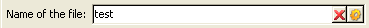

```
<input label="File name" type="editbtn" xpath="/tmp/@name">
  <enter>
    <soapCall name="GetAndTransform" service="ncm:content">
      <param exprIn="'https://myserver.adobe.com/incoming/' + [/tmp/@name] + '.xml'" type="string"/>
      <param exprIn="'xtk:xslt|cus:book-workflow.xsl'" type="string"/>
      <param type="DOMElement" xpathOut="."/>
    </soapCall>
  </enter>
</input>
```

편집 영역을 사용하여 검색할 파일의 이름을 입력할 수 있습니다. URL은 이 이름을 기반으로 생성됩니다(예: https://myserver.adobe.com/incomin/data.xml).

검색할 데이터의 형식은 워크플로우 자동화 예제 1과 동일합니다. 이 예제에서 볼 수 있는 &quot;cus:book-workflow.xsl&quot; 스타일시트를 사용합니다.

작업 실행 결과는 경로 &#39;.&#39;에서 콘텐츠 인스턴스를 업데이트합니다.
